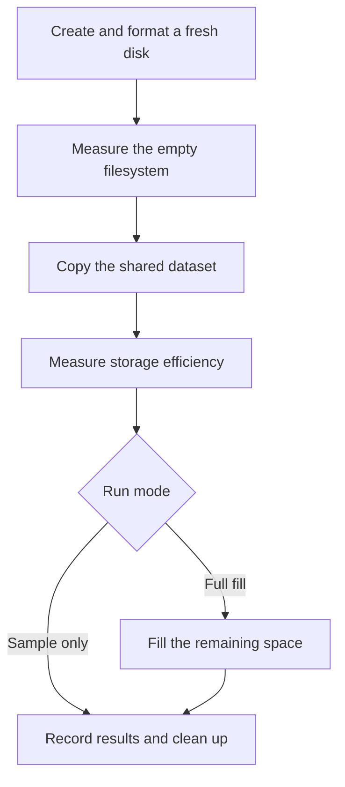

# Filesystem benchmark overview

How the test works and what the measurements mean.

[Open results](report.html) · [JSON results](report.json) · [Benchmark script](fsbench.py)

Compare how efficiently **EXT4, XFS, Btrfs, F2FS, NTFS and exFAT** use disk space,
with additional compression runs where supported.

| Default setting | Value | Notes |
| --- | --- | --- |
| Virtual disk | **100 GB** | 93.13 GiB; a fresh disk for every configuration. |
| Configurations | **6 + 3** | Six filesystems and three compression variants. |
| Shared workload | **Same source files** | One copy measures efficiency; repeated copies measure capacity. |

## The test flow

1. **Create and format a fresh disk.** Create a disposable virtual disk in the
   chosen folder, attach it as a verified loop device, then format and mount it
   with the selected filesystem.
2. **Measure the empty filesystem.** Measure the space available before any test
   files are copied, with reserved space reported separately from filesystem
   overhead.
3. **Copy the shared dataset.** Write exactly the same source files to every
   configuration using ordinary copies. Sync completed files so the measurements
   reflect allocated storage.
4. **Measure storage efficiency.** Record logical file sizes, reported allocation,
   estimated overhead and available compression statistics. Optional BLAKE3
   read-back verification checks the copied contents against the originals.
5. **Fill the remaining space (full mode only).** Repeat the dataset in new
   directories until the filesystem reaches its available-space or configured
   logical-data limit. Measure the amount actually stored.
6. **Record results and clean up.** Capture the final measurements, unmount the
   filesystem, detach its loop device and delete the image. Update the HTML and
   JSON reports before continuing to the next configuration.

### Full fill and sample-only modes

- **Full fill** measures the first copy, then repeats the dataset to discover
  usable capacity.
- **Sample only** stops after the first copy and its measurements, then cleans
  up. It skips filling the remaining space and does **not** measure full capacity.

### Two comparisons

| Comparison | What it measures |
| --- | --- |
| **Storage efficiency** | How much space the same dataset consumes, including filesystem overhead and compression savings. |
| **Usable capacity** | How much logical data fits when the dataset is repeated until available space or a configured limit is reached. |

## What the measured values mean

The capacity table describes the final fill. The efficiency table compares the
**same first copy** across configurations. Detailed snapshots are recorded when
the filesystem is empty, after that first copy, and after filling.

### Values in the comparison tables

| Measurement | Meaning |
| --- | --- |
| **Empty usable space** | Space available to ordinary users immediately after formatting. |
| **Empty reserved space** | Free space held back from ordinary users, such as EXT4's root reserve. |
| **Logical data / logical data stored** | Sum of file lengths before compression: the first copy's size or the final amount stored. Sample mode does not measure full capacity. |
| **File data allocation** | Space reported as allocated to file contents, including block rounding. Compressed Btrfs uses extent measurements when available. |
| **Final available** | Space still available to ordinary users when the run stops. |
| **Non-file overhead (est.)** | Disk size minus free filesystem space minus reported file allocation. Includes journals, directories, fixed structures and other accounting differences; excludes reserved free blocks. |
| **Btrfs metadata used** | Native metadata usage, counting both copies when metadata is duplicated. Can include small files stored inside metadata. |
| **Files stored** | Number of copied files present at the end. |
| **Extent / released savings** | Bytes saved by Btrfs extent compression, or compression reservation bytes released by F2FS. These use different filesystem-specific counters. |
| **Net saved vs baseline** | Reduction in space consumed by the first copy versus the uncompressed run of the same filesystem. Includes metadata and rounding effects; a negative value means compression consumed more space. |
| **Read-back** | Whether copied contents passed BLAKE3 verification, or verification was skipped. |
| **Write MiB/s** | First-copy logical bytes written per second, including file syncing and F2FS reservation release, excluding read-back verification. |
| **Status / stop reason** | Whether the run succeeded, failed, was skipped or interrupted, and whether filling stopped at a space or quota limit, a logical-data limit, or sample mode. |

### Additional values in run details

| Measurement | Meaning |
| --- | --- |
| **Virtual disk / shared dataset** | Image size, source-file bytes and source-file count. The default 100 GB disk is 93.13 GiB. |
| **Filesystem total, free and used** | The filesystem's reported space: used = total − free. Free includes reserved blocks; available excludes them. |
| **Unaddressable bytes** | Difference between image size and the filesystem's reported total. Already included in the overhead estimate. |
| **Block size** | Unit used to convert filesystem space counters into bytes. File allocation counters are separately expressed in 512-byte units. |
| **Inodes total / free** | Filesystem-reported capacity and availability of file records; interpretation varies by filesystem. |
| **Directories / directory allocation** | Number of copied directories, including the payload root, and their reported allocated space. Directory space is already part of the overhead estimate. |
| **Raw image host allocation** | Space allocated to the image on the host filesystem. Host compression and sparse allocation affect it; it measures a different layer from guest space. |
| **Btrfs allocation details** | Used data/system bytes, metadata space allocated versus actually used, and allocation-group profiles. Physical summaries account for duplicated copies. |
| **Btrfs compression details** | Physical extent size, original uncompressed extent size and referenced file bytes. Saved bytes and saving percentage compare original and physical extent sizes. |
| **F2FS released bytes** | Compression reservation bytes reclaimed so they become usable. Releasing them prevents further writes to those files without reserving space again. |
| **Paired file-allocation savings** | Difference in reported file allocation between the same first copy in baseline and compressed runs. Net-saving percentage instead compares total additional consumed space. |
| **Completed passes** | Number of complete copies of the workload, including the first copy. A final partial pass or tail files can add more data. |
| **Durations** | Seconds spent formatting, writing the first copy, filling further, running individual commands, and completing the whole configuration. |

## Read the results in context

- Capacity depends on the workload. Metadata overhead is estimated, and reserved
  free space is reported separately.
- Some counters overlap and should not be added together.
- A logical-data limit gives a lower bound on capacity.
- A dash means a value is unavailable or does not apply.
- Tool versions, commands, warnings and errors provide context for the
  measurements.

[Open the benchmark results](report.html)
