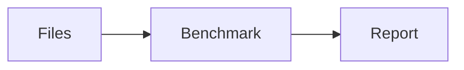

# Pan Mourovaty's benchmark archive

Static benchmark reports with a generated directory browser. Every public folder
gets its own `index.html`, so `/fsoverhead` and `/fsoverhead/` open that folder on
Cloudflare Pages. Nested folders support direct visits, refreshes, breadcrumbs,
parent links, and browser back/forward navigation.

## Repository layout and public URLs

All published content lives in `DATA/`. The build copies **the contents of DATA**
to `dist/`, so the repository's `DATA` directory never appears in site URLs:

| Repository source | Built file | Public URL |
| --- | --- | --- |
| `DATA/hardinfo2_report_hunt.html` | `dist/hardinfo2_report_hunt.html` | `/hardinfo2_report_hunt.html` |
| `DATA/fsoverhead/report.html` | `dist/fsoverhead/report.html` | `/fsoverhead/report.html` |
| `DATA/fsoverhead/` | `dist/fsoverhead/index.html` | `/fsoverhead/` |
| `DATA/_assets/browser.js` | `dist/_assets/browser.js` | `/_assets/browser.js` |

Cloudflare's existing redirects from `.html` to extensionless addresses still
apply. Build scripts, package files, tests, and this README remain at repository
root. Add new benchmark reports and sites inside `DATA/`, preserving their desired
public directory structure. Keep report assets alongside their reports as usual.

## Cloudflare Pages

Set these project build settings:

- **Build command:** `bash build.sh`
- **Build output directory:** `dist`
- **Node.js version:** 22.12 or newer (`NODE_VERSION=22` if needed)

The build installs the locked minifier dependency, copies public files from
`DATA/` into a temporary directory, generates directory indexes, and minifies **all** HTML
recursively, plus the custom browser JS/CSS, before replacing `dist`. Original
benchmark files stay intact.
A root `404.html` prevents Cloudflare's SPA fallback from showing the root listing
for nonexistent paths. Existing authored indexes and 404 pages are preserved.

Add reports and folders anywhere inside `DATA/`, commit them, and deploy as
usual. Dotfiles, symlinks, `node_modules`, `dist`, and `AGENTS.md` files inside
DATA are excluded from the output. Repository files outside DATA are excluded.
Shared UI assets in `DATA/_assets/` are deployed
under `/_assets/` and excluded from the listings. `DATA/_headers` and
`DATA/_redirects` are copied to the output root when present.
Sizes cover immediate files; dates use filesystem modification timestamps in UTC,
which can reflect checkout time on CI.

## UI dependencies

- Bootstrap **6.0.0-alpha.1**: Bootstrap 6 beta is not yet published as of October
  12, 2026. The available v6 prerelease is pinned. See the
  [official release announcement](https://blog.getbootstrap.com/2026/10/08/bootstrap-6-alpha/).
- HTMX **4.0.0** with its bundled `hx-preload` extension. Generated folder links
  preload on hover, focus, and touch, then swap the browser content and update
  history. Hover uses `mouseenter` so crossing a link's icon and label does not
  repeat the request.
- Font Awesome Free **7.3.1**: yellow folders and icons by file type.
- Marked **18.1.1**, Highlight.js **11.12.0**, and sanitize-html **2.18.0** render
  README Markdown and highlighted code during the build. No Markdown parser or
  syntax-highlighting JavaScript is shipped to visitors.
- Mermaid **12.1.0** loads as an ES module only when a displayed README has a
  Mermaid block. Folder navigation reuses the module and renders the new diagrams.

Libraries load from pinned jsDelivr URLs. Reports use regular document navigation
so their embedded styles and scripts keep working; hover/focus adds a native
document-prefetch hint. Filtering and sorting run locally. Directory and report
links still work with JavaScript disabled.

All three scripts on generated directory/404 pages load with `defer`: HTMX,
its preload extension, then the custom browser script. This preserves execution
order and runs after HTML parsing. `async` would not preserve the extension's
dependency on HTMX. The browser script explicitly uses `"use strict"`; the Node
build scripts are ES modules, which use strict mode automatically. Custom inline
scripts in the existing reports also use strict mode, including the sorting code
emitted by `fsbench.py`. The embedded Chart.js library keeps its existing strict
mode. Classic inline scripts cannot be deferred simply by adding the `defer`
attribute; extracting them to external files is a separate optimization.

## Folder READMEs

Add a `README.md` to `DATA/` or any public folder inside it. The generated index
shows its contents directly below the file listing, including headings, lists,
tables, images, inline code, and syntax-highlighted fenced snippets. Lowercase
`readme.md` is supported too. The raw Markdown remains available as a normal file.
The repository's root README stays outside DATA and is not published.

Use a language label on fenced code blocks, for example `python`, `javascript`,
`bash`, `json`, or `html`. Unspecified or unsupported languages remain readable
as plain code. Use `mermaid` for diagrams:

````markdown
# Benchmark notes

[Open the report](report.html)

```python
def benchmark():
    return 42
```


````

Relative links and image paths resolve from the README's folder, including on
direct visits without a trailing slash. Heading links such as `#benchmark-notes`
work within the rendered README. Markdown and code highlighting remain visible
with JavaScript disabled; Mermaid shows its source when diagrams cannot render.
Invalid diagrams retain their source and do not prevent other diagrams rendering.
Existing authored `index.html` pages are preserved rather than replaced by listings.

Same-site README links preload on hover, focus, and touch through HTMX's preload
extension. They keep normal browser navigation so standalone reports retain their
own styles and scripts. A custom HTMX trigger that browser clicks never fire lets
the extension fetch without swapping content. Requests use `cache: force-cache`
to warm the browser's HTTP cache; ordinary navigation may still revalidate when
the response's caching headers require it. Heading anchors and external links
are excluded, and preloading respects data-saving/slow-connection preferences.

## Further page-speed improvements

The browser already uses a system font, a preconnect hint for jsDelivr, minified
libraries, hover preloading, and document prefetching. The build minifies HTML,
inline JS/CSS, and the custom browser JS/CSS.

Further improvements, in order of likely benefit:

1. Extract repeated embedded chart libraries and base64 images from benchmark
   reports into shared external files. The largest source reports are about
   2.4 MB each; shared files can be cached across report visits. Keep chart setup
   after its dependencies and use `defer` for extracted scripts.
2. Build Bootstrap with only the components this browser needs, and replace
   Font Awesome's full CSS/font payload with the icons used here. Font Awesome
   recommends [loading only the styles you use](https://docs.fontawesome.com/web/setup/host-yourself/webfonts).
3. Give local JS/CSS filenames content hashes, then use `Cache-Control: public,
   max-age=31536000, immutable` for those hashed files. Keep directory HTML fresh.
   Cloudflare already caches Pages assets at the edge; avoid a blanket long TTL
   on pages or assets with unchanged filenames. See
   [Pages caching guidance](https://developers.cloudflare.com/pages/configuration/serving-pages/).

Measure the deployed site with browser Network/Performance tools before and after
larger changes; local file sizes do not measure compressed transfer size or latency.

## Local development

```bash
bash build.sh
python3 -m http.server 8000 --directory dist
```

Open `http://localhost:8000/`. Python's server redirects `/fsoverhead` to
`/fsoverhead/`; Cloudflare serves the generated index at the folder path.

For unminified output after installing the build dependencies:

```bash
npm ci --no-audit --no-fund
bash generate_index.sh dist
```

Running `bash generate_index.sh` without an argument also generates unminified
output in `dist/`. It reads `DATA/` and leaves source files untouched. Use
`bash build.sh` for the minified deployment build. Run generator regression tests
with `npm test`.
